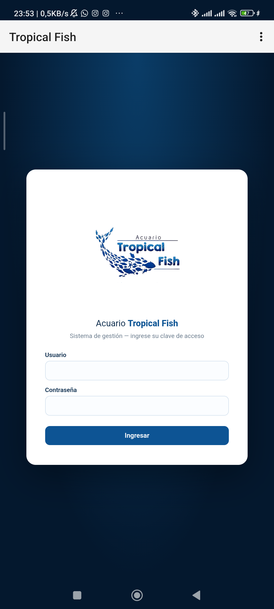

# Tropical Fish — App Android

Aplicación Android del sistema de gestión del **Acuario Tropical Fish**.

La app es un contenedor WebView que carga el sistema web publicado en
<https://tropical-fish.onrender.com/login>, de modo que toda la
funcionalidad del sistema web está disponible como aplicación instalable.

## Instalación

1. Descarga el APK desde la sección
   [Releases](https://github.com/Bueno1730/tropical-fish-app/releases)
   o el archivo `tropical_fish.apk`.
2. Cópialo al teléfono y ábrelo (Android pedirá permitir "instalar apps
   de orígenes desconocidos" la primera vez).

O con adb:

```bat
adb install -r tropical_fish.apk
```

## Compilar desde el código fuente

No requiere Gradle ni Android Studio: solo el Android SDK (build-tools)
y un JDK. Con Python:

```bat
python build_apk.py
```

Genera `build/tropical_fish.apk` firmado con el keystore de depuración.
El script compila los recursos con `aapt2`, el código Java con `javac`,
convierte a DEX con `d8`, alinea con `zipalign` y firma con `apksigner`.

## Captura


